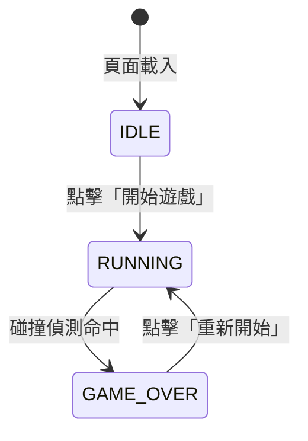
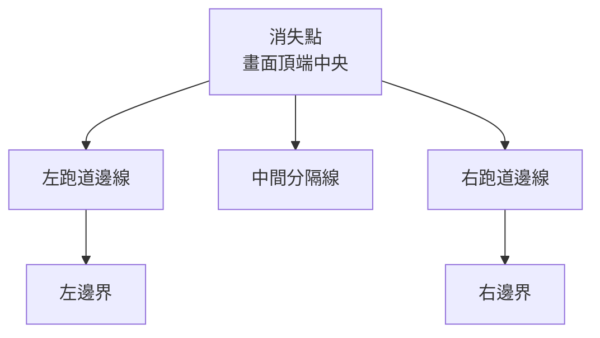

# 三線跑酷遊戲 — 技術設計文件

## Overview

本遊戲是一款以《地鐵跑酷》（Subway Surfers）為靈感的無盡三線跑酷瀏覽器遊戲，以純 HTML／CSS／JavaScript 實作，無需後端或第三方框架。玩家角色持續向前奔跑，玩家透過鍵盤左右方向鍵切換跑道來閃避障礙物、收集金幣累積分數，遊戲速度隨時間逐漸加快。

### 設計目標

- **零依賴**：僅使用原生瀏覽器 API（Canvas 2D、requestAnimationFrame、KeyboardEvent）。
- **單一 HTML 檔案**：所有 CSS 與 JavaScript 可內嵌於一份 `index.html`，方便部署。
- **60fps 流暢渲染**：使用 `requestAnimationFrame` 驅動的遊戲迴圈，delta-time 更新確保在不同裝置上速度一致。
- **明確的狀態機**：遊戲流程以有限狀態機管理，避免邏輯分散。

---

## Architecture

### 技術選擇

| 關注點 | 選擇 | 理由 |
|--------|------|------|
| 渲染 | HTML5 Canvas 2D API | 適合精確的幾何繪圖、碰撞偵測框設定，且不需要 DOM 更新 |
| 遊戲迴圈 | `requestAnimationFrame` + delta-time | 瀏覽器原生 VSync 同步，避免忙等待；滿足需求 8.2 |
| 狀態管理 | 簡易有限狀態機（FSM） | 清楚分離 IDLE、RUNNING、GAME_OVER 三種狀態 |
| 隨機性 | `Math.random()` | 已足夠滿足障礙物 / 金幣生成的隨機性需求 |
| 輸入 | `keydown` 事件監聽 | 鍵盤響應立即，不依賴輪詢；滿足需求 2.6 的 100ms 響應要求 |

### 遊戲狀態機



### 系統層次

```
┌──────────────────────────────────────┐
│              index.html              │
│  ┌────────────────────────────────┐  │
│  │         GameController         │  │  ← 狀態機、遊戲迴圈、輸入橋接
│  ├────────────────────────────────┤  │
│  │  GameState   │  InputHandler   │  │  ← 純資料 / 純輸入，無副作用
│  ├────────────────────────────────┤  │
│  │  SpawnManager│  PhysicsEngine  │  │  ← 物件生成 / 碰撞偵測
│  ├────────────────────────────────┤  │
│  │           Renderer             │  │  ← Canvas 繪圖，不含邏輯
│  └────────────────────────────────┘  │
└──────────────────────────────────────┘
```

---

## Components and Interfaces

### GameController

遊戲的頂層協調者，持有 FSM 狀態，驅動主迴圈。

```js
class GameController {
  constructor(canvas)
  start()                  // 從 IDLE 轉換到 RUNNING（需求 5.2）
  restart()                // 重置 GameState，轉換回 RUNNING（需求 5.5）
  _loop(timestamp)         // requestAnimationFrame 回呼（需求 8.2）
  _update(dt)              // 委派給 SpawnManager、PhysicsEngine
  _render()                // 委派給 Renderer
  _handleGameOver()        // 轉換到 GAME_OVER，顯示覆蓋層（需求 5.3）
}
```

**設計決策**：GameController 僅負責協調，不直接操作 Canvas 或計算碰撞，確保各模組可獨立測試。在 GAME_OVER 狀態下，`_update` 直接返回，不更新任何物件位置也不生成新物件（需求 3.5）。

---

### GameState

純資料物件，集中存放所有可變的遊戲狀態。

```js
const GameState = {
  phase: 'IDLE',           // 'IDLE' | 'RUNNING' | 'GAME_OVER'
  score: 0,                // 整數分數（需求 4.3）
  speed: 0,                // px/s，隨時間增加（需求 6.1）
  spawnInterval: 1.2,      // 秒，隨速度縮短（需求 6.2）
  playerLane: 1,           // 0=左, 1=中, 2=右（需求 1.2、5.2）
  obstacles: [],           // Obstacle[]
  coins: [],               // Coin[]
  elapsedTime: 0           // 秒，用於速度曲線
}
```

**設計決策**：將狀態集中於一個物件，方便 `restart()` 時一次性重置（需求 5.5、6.3），也讓 PhysicsEngine 等模組成為純函式（輸入狀態 → 輸出新狀態），便於屬性測試。

---

### InputHandler

捕捉鍵盤事件，將原始 `KeyboardEvent` 轉換為指令，防止重複按鍵在同一幀觸發多次移動。

```js
class InputHandler {
  constructor()
  get pendingMove()        // 'LEFT' | 'RIGHT' | null
  clearPendingMove()       // 每幀結束後呼叫
  _onKeyDown(e)            // keydown 監聽器
}
```

**設計決策**：使用「待處理指令」佇列（最多保留一個），而非直接修改 playerLane，確保每幀只移動一條跑道（需求 2.5）。

---

### SpawnManager

負責以隨機方式在三條跑道生成障礙物與金幣，並強制執行「至少一條跑道暢通」規則（需求 3.2）。

```js
class SpawnManager {
  constructor()
  trySpawn(state, dt)     // 根據計時器決定是否生成新物件
  _spawnObstacles(state)  // 隨機選取跑道，排除全封閉情況（需求 3.2）
  _spawnCoin(state)       // 隨機選取一條跑道生成金幣，避開有障礙物的跑道
}
```

**障礙物生成演算法**（滿足需求 3.2）：

```
1. 以隨機方式從 {0,1,2} 中抽取 1 或 2 條跑道
2. 若抽取結果覆蓋全部三條跑道 → 強制移除一條（隨機選取），確保至少一條暢通
3. 在選定跑道的畫面頂端生成障礙物
```

**生成頻率**：SpawnManager 以 `state.spawnInterval` 作為計時基準，`spawnInterval` 由 PhysicsEngine 隨速度更新（需求 6.2）。

---

### PhysicsEngine

無副作用的純函式集合，處理移動、碰撞偵測、物件清理與難度遞增。

```js
const PhysicsEngine = {
  update(state, dt) {
    // 1. 更新 elapsedTime
    // 2. 更新速度曲線（需求 6.1）
    // 3. 同步縮短 spawnInterval（需求 6.2）
    // 4. 移動所有障礙物與金幣（需求 1.3）
    // 5. 移除超出畫面底部的物件（需求 3.4、4.5）
    // 6. 偵測玩家與障礙物碰撞（需求 3.3、7.1~7.3）
    // 7. 偵測玩家與金幣重疊並更新分數（需求 4.2）
    // 回傳 { collided: bool, scoreGained: number }
  },
  _aabb(a, b)              // 軸對齊包圍盒碰撞（含收縮係數）
}
```

**碰撞偵測策略**（需求 7.1～7.3）：使用 AABB（軸對齊包圍盒），並在角色與障礙物的碰撞框上套用 **10% 收縮係數**（inset），避免視覺邊緣誤判。金幣收集判定使用略大於金幣半徑的容忍距離，使收集感覺自然。

**速度曲線**（需求 6.1）：

```
speed(t) = min(BASE_SPEED + ACCEL_RATE × t, MAX_SPEED)
```

`t` 為遊戲經過秒數。速度有上限（MAX_SPEED），防止遊戲變得不可操作。速度單調遞增直至上限。

**生成間隔曲線**（需求 6.2）：

```
spawnInterval(speed) = max(BASE_SPAWN_INTERVAL × (BASE_SPEED / speed), MIN_SPAWN_INTERVAL)
```

速度越高，生成間隔越短，障礙物出現頻率越高。

---

### Renderer

唯一負責 Canvas 繪圖的模組，讀取 GameState 但不修改它。

```js
class Renderer {
  constructor(ctx, width, height)
  draw(state)              // 主要繪圖入口
  _drawBackground()        // 跑道背景（含透視線條）
  _drawLanes()             // 三條跑道邊線（需求 1.1）
  _drawPlayer(lane)        // 角色（色塊）（需求 1.2）
  _drawObstacles(obs)      // 障礙物（紅色矩形）
  _drawCoins(coins)        // 金幣（黃色圓形）
  _drawHUD(score)          // 分數顯示（需求 4.3）
  _drawOverlay(phase)      // 開始/結束覆蓋層（需求 5.1、5.3、5.4）
}
```

**視覺風格**（需求 1.4）：採用偽 3D 透視——跑道線條從畫面底部（玩家視角）向上收斂至消失點，以梯形遠近感呈現深度，無需 WebGL。



---

## Data Models

### Lane（跑道索引）

```
0 = 左跑道
1 = 中跑道（預設起始）
2 = 右跑道
```

跑道的像素 X 座標由 Renderer 依畫布寬度動態計算，邏輯層只使用整數索引 0／1／2。

---

### Obstacle

```ts
interface Obstacle {
  lane: 0 | 1 | 2;   // 所在跑道
  y: number;          // 距畫面頂端的像素距離（往下增大）
  width: number;      // 視覺寬度（依跑道寬度決定）
  height: number;     // 固定高度（例如 60px）
}
```

---

### Coin

```ts
interface Coin {
  lane: 0 | 1 | 2;
  y: number;
  radius: number;     // 固定半徑（例如 15px）
  collected: boolean; // 標記為已收集，待下一幀移除
}
```

---

### Player

```ts
interface Player {
  lane: 0 | 1 | 2;   // 邏輯跑道索引
  // x、y 由 Renderer 依 lane 計算，不存入 state
}
```

玩家沒有獨立的 `y` 座標——角色固定在畫面下方約 78% 處，所有「移動感」來自障礙物 / 背景向下捲動。

---

### GameConfig（常數）

```js
const GameConfig = {
  CANVAS_WIDTH:         480,
  CANVAS_HEIGHT:        720,
  LANE_COUNT:           3,
  BASE_SPEED:           300,   // px/s
  ACCEL_RATE:           10,    // px/s 每秒
  MAX_SPEED:            800,   // px/s 上限
  BASE_SPAWN_INTERVAL:  1.2,   // 初始每批障礙物間隔（秒）（需求 5.5、6.3）
  MIN_SPAWN_INTERVAL:   0.4,   // 最短生成間隔下限（秒）
  OBSTACLE_HEIGHT:      60,    // px
  COIN_RADIUS:          15,    // px
  COLLISION_INSET:      0.10,  // 碰撞框收縮比例（10%）（需求 7.1）
  PLAYER_Y_RATIO:       0.78,  // 角色 Y 位置佔畫布高度比例
  MAX_DT:               0.1,   // delta-time 截斷上限（秒）
}
```

---

## Correctness Properties

*A property is a characteristic or behavior that should hold true across all valid executions of a system — essentially, a formal statement about what the system should do. Properties serve as the bridge between human-readable specifications and machine-verifiable correctness guarantees.*

**Property Reflection（消除冗餘）**

在撰寫最終屬性前，先進行冗餘審查：

- AC-2.1（左移進入 lane-1）、AC-2.3（左邊界不移動）、AC-2.5（每次只移動一條）可合併為「左移正確性」屬性，clamp 語義已隱含邊界與步長限制。
- AC-2.2（右移進入 lane+1）、AC-2.4（右邊界不移動）同理合併為「右移正確性」屬性。
- AC-3.3（碰撞→遊戲結束）與 AC-7.1～7.3（碰撞框精確度）語義相同，合併為一個屬性（overlapping → collided=true；non-overlapping → collided=false）。
- AC-4.4（分數重置）、AC-6.3（速度重置）均是 AC-5.5（restart 全狀態重置）的子集，合併為「重新開始完整重置狀態」屬性，不另立屬性。
- AC-4.5（金幣超出畫面→移除且分數不變）與 AC-3.4（障礙物超出畫面→移除）在邏輯上可合為一個「畫面外物件自動清除」屬性，再以 Property 5 單獨驗證金幣未收集不增分的不變式。
- 最終保留 10 個屬性，每一個提供獨立的驗證價值。

---

### Property 1: 左移正確性

*For any* 玩家當前跑道 `lane ∈ {0, 1, 2}`，執行一次「向左移動」指令後，新跑道必須等於 `max(lane - 1, 0)`，且前後跑道差值不超過 1。

**Validates: Requirements 2.1, 2.3, 2.5**

---

### Property 2: 右移正確性

*For any* 玩家當前跑道 `lane ∈ {0, 1, 2}`，執行一次「向右移動」指令後，新跑道必須等於 `min(lane + 1, 2)`，且前後跑道差值不超過 1。

**Validates: Requirements 2.2, 2.4, 2.5**

---

### Property 3: 物件向畫面底部移動

*For any* 遊戲狀態中的障礙物或金幣，在 `dt > 0` 的前提下呼叫 `PhysicsEngine.update(state, dt)` 後，該物件的 `y` 值必須大於更新前的 `y` 值（即物件向畫面下方移動）。

**Validates: Requirements 1.3**

---

### Property 4: 障礙物生成不全封閉

*For any* 單次 SpawnManager 生成呼叫，所生成的一批障礙物所佔用的跑道集合大小必須嚴格小於 3（即 ≤ 2），確保至少一條跑道暢通。

**Validates: Requirements 3.2**

---

### Property 5: 畫面外物件自動清除

*For any* 遊戲狀態，執行 `PhysicsEngine.update` 後，`state.obstacles` 與 `state.coins` 中不得存在任何 `y > CANVAS_HEIGHT` 的物件。

**Validates: Requirements 3.4, 4.5**

---

### Property 6: 碰撞偵測正確性

*For any* 障礙物，若其跑道索引與玩家相同且其 AABB（含收縮係數）與玩家 AABB 發生重疊，則 `PhysicsEngine.update` 必須回傳 `collided = true`；反之，若兩者 AABB 無重疊，則必須回傳 `collided = false`。

**Validates: Requirements 3.3, 7.1, 7.2, 7.3**

---

### Property 7: 金幣收集增加分數

*For any* 遊戲狀態，若存在一枚金幣其跑道與玩家相同且位置與玩家重疊，則執行 `PhysicsEngine.update` 後，`state.score` 必須恰好增加 1，且該金幣必須從 `state.coins` 中移除。

**Validates: Requirements 4.2**

---

### Property 8: HUD 分數顯示與狀態一致

*For any* 非負整數 `score` 值，呼叫 `Renderer._drawHUD(score)` 後，Canvas 繪製的 HUD 區域所呈現的文字必須包含該數值的字串表示。

**Validates: Requirements 4.3**

---

### Property 9: 重新開始完整重置狀態

*For any* 遊戲狀態（任意分數、任意障礙物、任意金幣數量、任意速度），呼叫 `GameController.restart()` 後，`state` 必須滿足：`score === 0`、`playerLane === 1`、`obstacles.length === 0`、`coins.length === 0`、`speed === BASE_SPEED`、`spawnInterval === BASE_SPAWN_INTERVAL`、`phase === 'RUNNING'`。

**Validates: Requirements 4.4, 5.5, 6.3**

---

### Property 10: 速度單調遞增且有上限

*For any* 兩個經過時間 `t1 < t2`（均為非負實數），`speed(t2) >= speed(t1)`（速度不遞減）；且對所有 `t`，`speed(t) <= MAX_SPEED`（速度不超出上限）。

**Validates: Requirements 6.1**

---

### Property 11: 生成間隔隨速度縮短

*For any* 兩個速度值 `s1 < s2`（均不超過 MAX_SPEED），對應的 `spawnInterval(s1) >= spawnInterval(s2)`（速度越高，間隔越短或相等）。

**Validates: Requirements 6.2**

---

## Error Handling

### 邊界條件

| 情境 | 處理方式 |
|------|---------|
| 玩家在邊界跑道繼續按同方向鍵 | `clamp(lane ± 1, 0, 2)`，靜默忽略，不觸發錯誤（需求 2.3、2.4） |
| `requestAnimationFrame` 回呼間隔異常大（例如切換分頁後回來） | `dt = min(dt, MAX_DT)`（0.1 秒），防止物理步驟過大導致物件穿透 |
| 畫布尺寸不足（視窗縮小） | Canvas 以固定 480×720 呈現，外層 CSS 以 `object-fit: contain` 等比縮放，遊戲邏輯不受影響 |
| 同幀生成障礙物與金幣位置完全重疊 | 金幣生成時跳過已有障礙物的跑道（SpawnManager 過濾） |
| SpawnManager 迴圈超過 10 次仍無法滿足暢通跑道條件 | 強制跳過本次生成（防衛性 fail-safe），確保遊戲不卡死 |
| 遊戲處於 GAME_OVER 狀態時收到鍵盤輸入 | InputHandler 繼續接收事件，但 GameController 在 GAME_OVER 階段不呼叫 `_update`，輸入被靜默忽略 |

### 防護措施

- `PhysicsEngine.update` 接受 `dt` 前先做 `Math.min(dt, MAX_DT)` 截斷，防止 delta-time 爆炸。
- SpawnManager 在每次生成障礙物時驗證「暢通跑道 ≥ 1」。
- 所有陣列操作使用 `filter` 回傳新陣列，避免迭代中修改同一陣列（防止隱性 bug）。
- 速度與生成間隔均設有上下限（`MAX_SPEED`、`MIN_SPAWN_INTERVAL`），防止難度無限膨脹。

---

## Testing Strategy

### 測試分層

#### 單元測試（Unit Tests）

針對純函式模組，使用 **Vitest**（JavaScript 標準測試框架）。

**PhysicsEngine**
- 碰撞偵測：明確重疊 → `collided=true`；明確分離 → `collided=false`；邊界切線（近似接觸）→ 依收縮係數決定。
- 畫面外清除：`y > CANVAS_HEIGHT` 的障礙物與金幣在 update 後消失。
- 金幣收集：重疊金幣被移除且分數增加 1；未重疊金幣保留且分數不變。
- 速度曲線：`speed(0) === BASE_SPEED`；`speed(t)` 隨 `t` 遞增；`speed(∞) === MAX_SPEED`。
- 生成間隔曲線：`spawnInterval` 隨速度升高而縮短，不低於 `MIN_SPAWN_INTERVAL`。

**SpawnManager**
- 生成結果永遠不全封閉（三條跑道均有障礙物）。
- 金幣不生成在有障礙物的跑道。

**GameController / GameState**
- `restart()` 後所有欄位回到初始值（score=0、playerLane=1、obstacles=[]、coins=[]、speed=BASE_SPEED、spawnInterval=BASE_SPAWN_INTERVAL、phase=RUNNING）。
- 狀態機轉換：IDLE → RUNNING → GAME_OVER → RUNNING。
- GAME_OVER 狀態下 update 不移動物件也不生成新物件。

**InputHandler**
- 左鍵在任意跑道產生正確的 `pendingMove = 'LEFT'`。
- 右鍵在任意跑道產生正確的 `pendingMove = 'RIGHT'`。
- `clearPendingMove` 後 pendingMove 為 null。

---

#### 屬性測試（Property-Based Tests）

使用 **fast-check**（JavaScript PBT 函式庫），每個屬性最少執行 **100 次**隨機迭代。

| 屬性 | 測試標籤 |
|------|---------|
| Property 1 | `Feature: runner, Property 1: 左移正確性` |
| Property 2 | `Feature: runner, Property 2: 右移正確性` |
| Property 3 | `Feature: runner, Property 3: 物件向畫面底部移動` |
| Property 4 | `Feature: runner, Property 4: 障礙物生成不全封閉` |
| Property 5 | `Feature: runner, Property 5: 畫面外物件自動清除` |
| Property 6 | `Feature: runner, Property 6: 碰撞偵測正確性` |
| Property 7 | `Feature: runner, Property 7: 金幣收集增加分數` |
| Property 8 | `Feature: runner, Property 8: HUD 分數顯示與狀態一致` |
| Property 9 | `Feature: runner, Property 9: 重新開始完整重置狀態` |
| Property 10 | `Feature: runner, Property 10: 速度單調遞增且有上限` |
| Property 11 | `Feature: runner, Property 11: 生成間隔隨速度縮短` |

屬性測試著重於 PhysicsEngine、SpawnManager、InputHandler 等純邏輯層；Renderer 的 Canvas 視覺輸出以 Property 8 的 HUD 字串比對為主，整體像素輸出改用快照測試。

---

#### 整合測試（Integration Tests）

以少數具代表性的範例驗證系統整體流程：

1. **完整遊戲週期**：載入 → 開始（phase=RUNNING）→ 模擬若干幀 → 模擬碰撞 → 確認進入 GAME_OVER → 重新開始 → 確認狀態乾淨（score=0、obstacles=[]）。
2. **分數累積**：連續收集 N 枚金幣，確認最終 `score === N`。
3. **難度遞增**：模擬 60 秒遊戲時間，確認結束時 `speed > BASE_SPEED` 且 `spawnInterval < BASE_SPAWN_INTERVAL`。
4. **GAME_OVER 靜止**：進入 GAME_OVER 後呼叫若干幀 update，確認障礙物位置與數量不變。

---

#### 煙霧測試（Smoke Tests）

手動在 Chrome、Firefox、Edge 最新版開啟 `index.html`，確認：

- 頁面載入後顯示三條跑道與 StartScreen（需求 1.1、5.1）。
- 點擊「開始遊戲」後遊戲啟動，角色在中間跑道（需求 1.2、5.2）。
- 鍵盤左右鍵可控制角色切換跑道，視覺反應在 100ms 以內（需求 2.6）。
- 遊戲可正常碰撞結束並顯示 GameOverScreen（需求 5.3、5.4）。
- 點擊「重新開始」後狀態乾淨，遊戲重新啟動（需求 5.5）。
- 動畫流暢，目視不低於 30fps（需求 8.1）。
- 所有畫面以 2D 幾何色塊呈現，無 JavaScript 錯誤（需求 1.4、1.5）。

---

### 測試執行

```bash
# 單元測試 + 屬性測試（單次執行，非 watch 模式）
npx vitest --run
```

> **注意**：請在終端機手動執行上述指令。請勿以 `--watch` 模式執行，以免阻塞開發環境。
